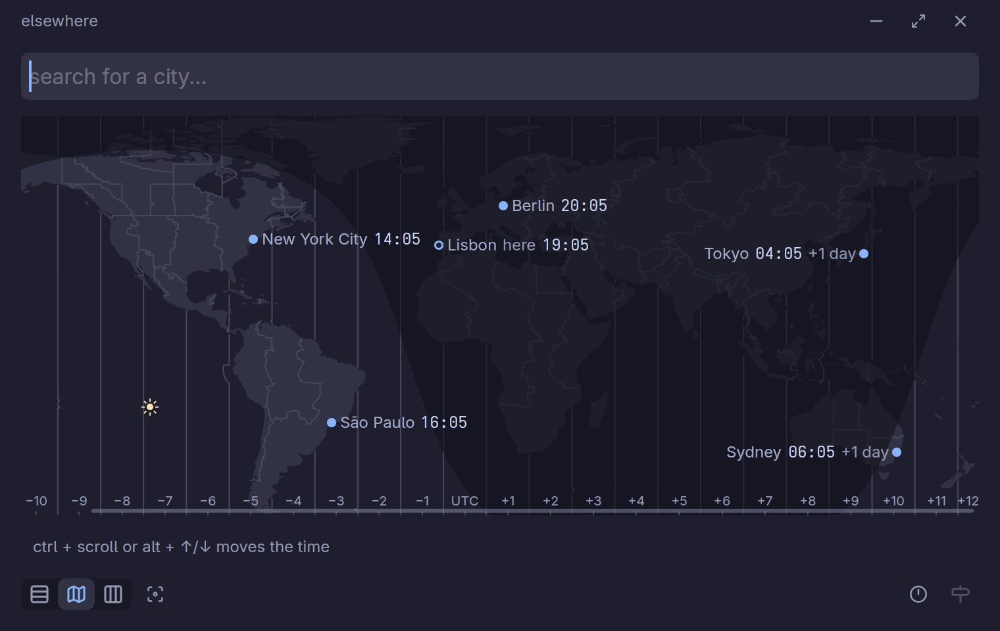
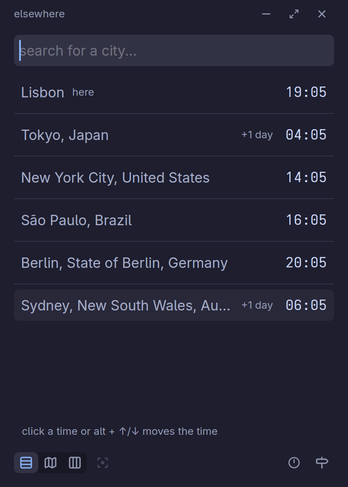

# elsewhere
Check the time in other places.

<p>
  
  
</p>

## Install

Download the latest build from
[Releases](https://github.com/insomniodev/elsewhere/releases).

**Linux** (x86_64): unpack into `~/.local` to get the app, its launcher entry
and icon:

```sh
tar -xzf elsewhere-*-x86_64-unknown-linux-gnu.tar.gz -C ~/.local --strip-components=1
```

**Windows** (x86_64): unzip anywhere and run `elsewhere.exe`.

**From source** (any platform gpui supports):

```sh
cargo install --locked --git https://github.com/insomniodev/elsewhere
```

macOS builds are not published yet, as they are untested.

## Shortcuts

| Key | Action |
|---|---|
| `↑` `↓` / `Enter` | Move through / pick a search result |
| `Esc` | Clear the search, cancel an edit, or return to now |
| `Alt+↑` / `Alt+↓` | Step the shown time 15 minutes earlier / later |
| `Tab` / `Shift+Tab` | Move to the next / previous control |
| `Enter` / `Space` | Press the focused button |
| `Enter` | Edit the focused city's time |
| `Delete` | Remove the focused city |
| `Ctrl+↑` / `Ctrl+↓` | Move the focused city up / down the list |
| `←` `→` `↑` `↓` / `Enter` | Move through / pick an hour in the grid |
| `Ctrl+1` / `2` / `3` | Show the list / map / grid |
| `Ctrl+W` / `Ctrl+Q` | Close the window / quit |

On macOS, `Cmd` stands in for `Ctrl` in the last two rows.

Click a time to type a what-if time; scroll over the map to scrub, or click an
hour in the grid.

## Architecture

- A [gpui](https://www.gpui.rs) app. `src/app/` holds the UI: the search, and
  the list, map and grid views.
- `src/*.rs` holds the gpui-free logic: time readings, search, sun position,
  saved cities.
- City, land and time zone data are TSVs in `data/`, embedded in the binary.
  The generators in `src/bin/` build them from the upstream sources
  (`cargo run --features gen --bin <name>`); see `data/manifest.toml`.
- Saved cities live in `~/.config/elsewhere/saved` (`%APPDATA%` on Windows).

## License

[MIT](license.md). Bundled icons and data: [third-party licenses](third_party_licenses.md).
